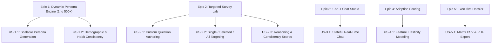

# Agile Project Documentation — REGALUX AI (Synthetic Users)

> **Platform:** REGALUX AI — Synthetic User Research & Product Validation Suite  
> **Repository:** [harshika-Y/synthetic-users](https://github.com/harshika-Y/synthetic-users)  
> **Methodology:** Agile Scrum with 2-Week Sprints & Kanban Flow  
> **Version:** 2.4.0  
> **Status:** Active Production  

---

## 1. Executive Summary & Product Vision

### 1.1 Product Vision Statement
To empower product managers, UX researchers, and venture architects with an autonomous, high-fidelity **Synthetic User Research Simulator** that models realistic consumer decision-making. By simulating diverse customer cohorts with grounded demographic, economic, and psychographic attributes, teams can validate product hypotheses, test pricing elasticity, and discover friction points in minutes rather than months.

### 1.2 Core Business Objectives
- **Accelerate Discovery Velocity:** Reduce qualitative and quantitative research turnaround from 4–6 weeks to under 5 minutes.
- **Dynamic Scale:** Generate and survey from 1 to 500+ statistically distinct, non-duplicated synthetic consumer personas on demand.
- **Targeted Precision:** Enable granular question authoring and cohort targeting (single person deep-dive, custom segment filter, or full-cohort matrix).
- **Explainable AI:** Ensure every synthetic response is backed by internal persona reasoning, verbatim quotes, and verifiable consistency scores.

---

## 2. Agile Framework & Governance

### 2.1 Methodology: Scrum-Ban Hybrid
The team utilizes **Scrum** for sprint planning, fixed 2-week iterations, and milestone commitments, complemented by **Kanban** for continuous pipeline flow during sprint execution:
- **Sprint Length:** 2 Weeks (10 Business Days)
- **Deployment Cadence:** Continuous Delivery to Staging; Automated Production Release at Sprint Close
- **Velocity Target:** 38 Story Points per Sprint

### 2.2 Stakeholder & Team RACI Matrix

| Role | Name / Title | Responsibilities | RACI |
| :--- | :--- | :--- | :---: |
| **Product Owner (PO)** | Harshika Y. | Product backlog prioritization, user story acceptance, stakeholder alignment | **A / R** |
| **Scrum Master (SM)** | Agile Coach | Ceremony facilitation, impediment removal, sprint health tracking | **R** |
| **AI / ML Architect** | Lead AI Engineer | Persona engine, LLM prompting architecture, vector memory retrieval | **R** |
| **Full-Stack Developer**| Senior Engineer | React 19 UI, FastAPI endpoints, SQLAlchemy ORM, Survey Lab matrix | **R** |
| **UX / UI Strategist** | Product Designer | Royal Emerald visual design system, accessibility, responsive flows | **C** |
| **QA Automation Lead** | SDET | Pytest integration suite, Vitest UI suites, synthetic validation benchmarks | **C** |

*R = Responsible, A = Accountable, C = Consulted, I = Informed*

---

## 3. Agile Ceremonies & Working Agreements

### 3.1 Sprint Cadence Schedule
1. **Sprint Planning (Day 1, 09:30 AM — 2 Hours):** Review prioritized backlog, estimate story points (Planning Poker / Fibonacci sequence), commit to Sprint Goal.
2. **Daily Standup (Every Day, 09:15 AM — 15 Mins):**
   - What did I achieve yesterday?
   - What will I commit to today?
   - What blockers or dependencies impede my progress?
3. **Backlog Refinement (Day 6, 02:00 PM — 1 Hour):** Flesh out user stories, write detailed Acceptance Criteria (Gherkin format), re-estimate complexity.
4. **Sprint Review & Stakeholder Demo (Day 10, 03:00 PM — 1 Hour):** Live functional demonstration of deployed capabilities to executive stakeholders.
5. **Sprint Retrospective (Day 10, 04:30 PM — 45 Mins):** Mad / Sad / Glad analysis, process improvement action items logged in engineering board.

### 3.2 Definition of Ready (DoR)
A User Story is marked **Ready for Sprint Backlog** when:
- [x] Clear business value statement written in standard template: *"As a... I want to... So that..."*
- [x] Unambiguous, testable **Acceptance Criteria** written in Given-When-Then format.
- [x] UI mockups and design token references provided in tickets.
- [x] Dependencies identified, vetted, and unblocked.
- [x] Sized and estimated by the cross-functional team (≤ 8 Story Points).

### 3.3 Definition of Done (DoD)
A User Story is marked **Done** when:
- [x] Feature implementation meets all Acceptance Criteria.
- [x] Code passes ESLint and Python Flake8/Black static analysis without warnings.
- [x] Unit and integration tests pass with ≥ 85% test coverage.
- [x] Pull Request approved by at least 1 peer reviewer.
- [x] Successfully deployed to staging environment with zero regressions.
- [x] Documentation updated in `README.md` and API specifications.
- [x] Signed off by Product Owner during Sprint Review.

---

## 4. Product Backlog & Epics Breakdown

### Epic 1: Scalable Synthetic Persona Engine
**Goal:** Empower users to generate, configure, and inspect statistically authentic personas ranging from 1 to 500+ individuals.

- **US-1.1: Configurable Persona Count Generation**
  - *Priority:* MoSCoW: **Must Have** | *Points:* 5
  - *Story:* As a market researcher, I want to specify an exact quantity of synthetic personas (from 1 to 500+) and define my custom target criteria, so that I can scale study sample size without artificial caps.
  - *Acceptance Criteria:*
    - Given a user in Persona Studio, when they open the synthesis modal, then they can input any custom count up to 500+ or choose quick presets (1, 5, 10, 25, 50, 100, 200, 500).
    - When generation is triggered, the backend persona engine creates unique profiles with realistic names, Indian city locations, routines, and budgets.

- **US-1.2: Archetype Customization & Filtering**
  - *Priority:* **Must Have** | *Points:* 3
  - *Story:* As an analyst, I want to filter personas by professional segment (Budget-conscious, Time-pressed, Health-conscious, Night-shift), so that I can inspect subgroup demographics.
  - *Acceptance Criteria:*
    - Clicking a segment tab immediately isolates personas matching the criteria.

---

### Epic 2: Targeted Survey Lab & Dynamic Question Authoring
**Goal:** Run high-speed multi-question surveys targeting specific cohorts or individual personas with full rationale transparency.

- **US-2.1: Multi-Format Question Authoring**
  - *Priority:* **Must Have** | *Points:* 8
  - *Story:* As a product manager, I want to author my own research questions with multiple formats (Single Choice, Rating Scale 1–5, Likert Scale, Yes/No, Open-Ended), so that I can test exact product hypotheses.
  - *Acceptance Criteria:*
    - Users can add, edit, or remove questions in the survey builder.
    - Quick template buttons auto-populate validated hypotheses (₹99 Delivery Fee, Morning Pass, Nutrient Disclosures).

- **US-2.2: Granular Cohort Scope Targeting (Single / Selected / All)**
  - *Priority:* **Must Have** | *Points:* 5
  - *Story:* As a user researcher, I want to conduct surveys against an individual person, a selected hand-picked group, or all personas, so that I can contrast micro-feedback against broad market trends.
  - *Acceptance Criteria:*
    - The scope selector toggles between "Single Person", "Selected", and "All".
    - When "Single Person" is selected, the Survey Lab presents an executive dossier view of that individual's responses.
    - When "All" or "Selected" is chosen, an interactive side-by-side matrix displays answers with color-coded sentiment.

- **US-2.3: Persona Reasoning & Consistency Score Inspection**
  - *Priority:* **Should Have** | *Points:* 5
  - *Story:* As an executive, I want to see the exact grounded reasoning behind each synthetic user's answer, so that I understand *why* they approve or reject an idea.
  - *Acceptance Criteria:*
    - Clicking "View Rationale & Consistency" opens an inspection modal displaying verbatim reasoning and a verified consistency score (e.g. 96%).

---

### Epic 3: 1-on-1 Interactive Interview Studio
**Goal:** Provide a conversational interface to interrogate synthetic personas in real time.

- **US-3.1: Stateful Persona Chat with Voice Tone Grounding**
  - *Priority:* **Must Have** | *Points:* 5
  - *Story:* As a researcher, I want to interview individual personas in real-time chat, so that I can ask probing follow-up questions about their morning routine, food delivery habits, and willingness to pay.
  - *Acceptance Criteria:*
    - Personas reply in their natural tone (e.g. busy IT architect, budget-conscious student).
    - Responses maintain stateful context across multi-turn exchanges.

---

### Epic 4: Adoption Scoring & Hypothesis Modeling
**Goal:** Convert qualitative survey and interview data into quantifiable market viability metrics.

- **US-4.1: Feature Viability & Price Elasticity Scoring**
  - *Priority:* **Should Have** | *Points:* 5
  - *Story:* As a venture strategist, I want composite adoption potential scores (0–100%) for evaluated features, so that I can determine feature go/no-go decisions.

---

### Epic 5: Executive Reporting & Data Export
**Goal:** Deliver boardroom-ready deliverables in both tabular (CSV) and document (PDF) formats.

- **US-5.1: Matrix CSV Export & Comprehensive Dossier**
  - *Priority:* **Could Have** | *Points:* 3
  - *Story:* As an analyst, I want to export survey matrices as standard CSV files, so that I can ingest findings into external BI tools (Excel, Tableau, Looker).

---

## 5. Sprint Execution Roadmap

| Sprint | Focus Area | Key Deliverables | Status |
| :--- | :--- | :--- | :---: |
| **Sprint 1: Architecture & Foundation** | Backend schemata, SQLite/MySQL ORM, core FastAPI routers, JWT auth | Basic persona endpoints, experiment models, database migrations | **Completed** |
| **Sprint 2: Persona Studio & Scale** | Synthesis engine, dynamic generation scale (1 to 500+ personas), segment filters | Persona Studio UI, custom quantity input, persona comparator | **Completed** |
| **Sprint 3: Survey Engine & Multi-Scope** | Survey Lab with question authoring, targeting modes (single, selected, all) | Interactive Survey Lab, custom question builder, matrix table | **Completed** |
| **Sprint 4: 1-on-1 Studio & AI Bridge** | Real-time chat engine, vector memory retrieval, Groq LLM integration | Interview Room studio, live sentiment tagging | **Completed** |
| **Sprint 5: Visual Theme & Production Polish** | Kadappa Royal Emerald palette, CSV export, responsive design polish | Final clean UI, complete documentation, repository public release | **Completed** |

---

## 6. Risk Register & Mitigation Strategy

| Risk ID | Description | Impact | Probability | Mitigation Strategy | Owner |
| :---: | :--- | :---: | :---: | :--- | :---: |
| **RSK-01** | Persona generation takes too long for large cohorts (>200 personas) | High | Medium | Batch async generation with localized archetypes and synthetic caching | AI Architect |
| **RSK-02** | Hallucinations in synthetic answers violating persona budget | High | Low | Prompt system constraints enforcing strict demographic grounding and budget checks | AI Architect |
| **RSK-03** | Rate limits when querying external LLM APIs | Medium | High | Local high-speed simulation fallback engine with zero external dependencies | Backend Lead |
| **RSK-04** | Misinterpretation of synthetic research as human sample | High | Low | Mandatory UI disclaimers and synthetic badges embedded throughout the platform | Product Owner |

---

## 7. Quality Assurance & Testing Standards

- **Backend Integration Tests:** `pytest -v backend/tests` covers all survey generation, targeting modes, and schema validations.
- **Frontend Build Validation:** `npm run build` automated check verifying zero compilation and type errors before every release.
- **Continuous Integration:** Automated GitHub Actions running lint, test suites, and packaging on every pull request to `main`.

---

## 8. Git Branching & Contribution Workflow

1. **Main Branch (`main`):** Production-ready code only. Directly deployable.
2. **Feature Branches (`feature/name`):** Branch from `main`, implement story, open Pull Request.
3. **Commit Convention:** Conventional Commits:
   - `feat:` New features or user stories
   - `fix:` Bug fixes
   - `docs:` Documentation updates
   - `style:` Design, CSS, layout tweaks
   - `refactor:` Code refactoring without behavior changes
4. **Pull Request Protocol:** Minimum 1 peer approval + clean automated build required for merge.
